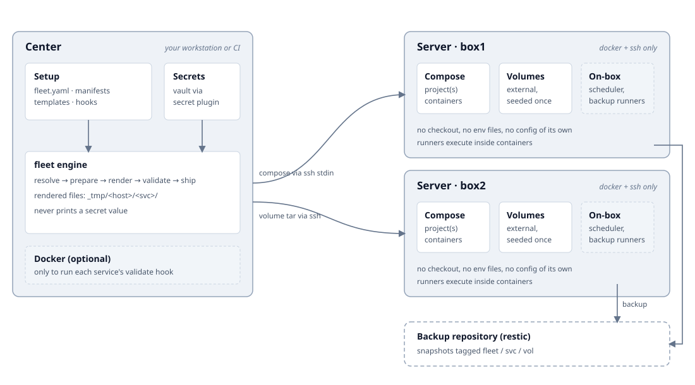

# fleet

A center-side control plane for a fleet of Docker Compose hosts.

- **One center machine** holds the inventory, the service manifests and the secrets.
- **Servers hold only ssh and Docker.** Nothing is checked out or configured on them.
- **Deploys are a stream.** The center renders Compose files and pipes them over ssh to `docker compose`.

This repository is the engine.
It contains no inventory, no service manifests and no secrets.

## Prerequisites

On the **center** machine:

- [Bun](https://bun.sh) — runtime and package manager
- [gomplate](https://docs.gomplate.ca) — renders `*.tmpl` files
- [Docker](https://www.docker.com) — required for `validate`; rendering itself is pure
- `ssh` — transport to every host
- `openssl` — decrypts repo `.enc` files

On each **server**:

- Docker (with the compose plugin)
- ssh access

A secret provider is needed only when a template calls `secret`.
The shipped `secret.sh` uses [fnox](https://fnox.jdx.dev/);
set `FLEET_SECRET_PLUGIN` for any compatible executable.

## Architecture



The diagram groups components by the machine they run on.
The center is the only machine with state worth protecting; servers can be rebuilt from it.

Three layers live on the center:

- **Inventory** (`fleet.yaml`) — servers as `name -> ssh target`, plus shared env defaults. Target `localhost` runs on the center. A gitignored `fleet.local.yaml` merges over it key by key.
- **Services** (`<svc>/service.yaml`) — one Compose project per directory. Declares deploy scope, env, external volumes and backup inputs. `compose.yml.tmpl` is the Compose file. An optional `prepare.ts` derives committed values or validates the rendered tree.
- **Secrets** — templates never see the vault. The renderer exposes one gomplate plugin, `secret`, implemented by an executable that prints a named value. Resolved values live only in memory and in `_tmp/`, and are never printed.

A deploy:

1. **Resolve** — read `fleet.yaml`, the manifest and `generated-envs.json`. Env is layered: `fleet default < fleet <host> < service default < service <host>`.
2. **Prepare** — run the service's `prepare.ts` table: derive or verify committed values from the vault.
3. **Render** — gomplate renders `compose.yml.tmpl` and `.tmpl` volume sources into `_tmp/<host>/<svc>/`. `FLEET_HOST` is injected last, so a manifest cannot forge it.
4. **Validate** — the optional `validate` hook runs per host, usually by executing the service's own image (e.g. `caddy adapt`). Docker is optional; without it the check warns and skips.
5. **Ship** — the compose file is streamed over ssh stdin to `docker compose -f -`. Volume content is streamed as a tar into a throwaway container. No value travels through argv or a server-side file.

`down` skips prepare, so a service can still be stopped after its committed values stop validating.

Volumes and backups:

- Declared volumes are **external** — the name must match the Compose template. `up` gates on existence; `setup-volumes` creates and seeds only when empty; `push-volumes` overwrites explicitly.
- A volume's `backup` set (`sqlite` and/or `file`) is snapshotted as one restic snapshot, tagged `fleet`/`svc=<svc>`/`vol=<vol>`. SQLite entries are staged with `.backup` first, so a live database is safe to copy.
- A live database with a Compose-managed data volume declares `backup.dumps` instead: each command runs inside the service's own container and its stdout becomes `/<svc>/dumps/<name>.sql` in a snapshot.
- Restic credentials come from an encrypted env file (`_envs/fleet-backup.env.enc` by default), unlocked by `FLEET_ENCRYPTION_KEY` from the vault.

**On-box jobs** (`onbox/cli.ts`) — the in-container entry, dispatched by a
service's scheduler (`backup-db`, `backup-prune`). A setup bundles it with
`bun build --target=bun` into one file for the volume, so the container
needs no engine checkout. Service-agnostic; setup-specific scripts live in
the setup and are copied alongside.

## Commands at a glance

| Goal                        | Command                                                              |
| --------------------------- | -------------------------------------------------------------------- |
| Preview rendered output     | `fleet render <svc> [hosts...]`                                      |
| Create networks on hosts    | `fleet setup [hosts...]`                                             |
| Deploy / restart / stop     | `fleet up` / `restart` / `down <svc>`                                |
| Create or overwrite volumes | `fleet setup-volumes` / `push-volumes <svc>`                         |
| See what is running         | `fleet status [hosts...]`                                            |
| Back up, restore            | `fleet dump-backup`, `restic-backup`, `restic-restore`, `pg-restore` |
| Inspect secrets             | `fleet secret list` / `check` / `show`                               |

Run `fleet --help` for the full list and arguments.

## Quick start

```sh
# A setup is a directory with a fleet.yaml and one folder per service.
mkdir my-fleet && cd my-fleet
```

```yaml
# fleet.yaml
servers:
  box1: user@box1.example.com
env:
  default:
    FLEET_DEFAULT_IMAGE: my.registry.example.com/base:latest
```

```yaml
# myservice/service.yaml
servers:
  - box1
env:
  default:
    APP_HOST: app.example.com
volumes:
  myservice_data:
```

```yaml
# myservice/compose.yml.tmpl
services:
  app:
    image: myservice:latest
    volumes:
      - myservice_data:/data
volumes:
  myservice_data:
    external: true
networks:
  default:
    name: gateway
    external: true
```

Then:

```sh
# Install the engine as a package (for prepare.ts hooks).
bun add file:../fleet

# Render (writes _tmp/<host>/myservice/, nothing is pushed).
bunx fleet render myservice

# Create the networks, apply it everywhere.
bunx fleet setup
bunx fleet up myservice
```

For the full service schema, template rules and hooks, see [docs/creating-a-stack.md](docs/creating-a-stack.md).

## Using it

```sh
bunx fleet --help
```

Run from the setup root, or point at it explicitly:

```sh
FLEET_ROOT=/path/to/setup bunx fleet status
```

The CLI is the reference for verbs and arguments: `--help` on the program or any command.
Host arguments default to the inventory (or the service's declared scope).
`exec`, `volume run` and `env` hand their tail to another command after `--`.

Install the engine as a local package:

```json
{ "dependencies": { "fleet": "file:../fleet" } }
```

```ts
import { define, readSecret, type ServiceHook } from "fleet";
```

`package.json` exports the hooks surface (`fleet` -> `mod.ts`) and the on-box manifest factory (`fleet/onbox/manifest`).

## Configuration

| Variable                                       | Default                                      | Purpose                    |
| ---------------------------------------------- | -------------------------------------------- | -------------------------- |
| `FLEET_ROOT`                                   | nearest `fleet.yaml` from PWD                | setup root                 |
| `FLEET_TMP_DIR`                                | `<root>/_tmp`                                | rendered previews          |
| `FLEET_ENV_DIR`                                | `<root>/_envs`                               | encrypted env files        |
| `FLEET_BACKUP_ENV`                             | `fleet-backup.env.enc`                       | restic credentials         |
| `FLEET_SECRET_PLUGIN`                          | `<fleet>/secret.sh`                          | secret provider            |
| `FLEET_VAULT_FILES`                            | `fnox.toml,fnox.local.toml,.fnox.local.toml` | `secret list/check`        |
| `FLEET_CLI`                                    | `fleet`                                      | how hints name the command |
| `FLEET_GATEWAY_NETWORK` / `FLEET_EDGE_NETWORK` | `gateway` / `edge`                           | `setup`                    |
| `GW_SUBNET` / `EDGE_SUBNET`                    | `172.16.0.0/16` / `172.30.0.0/16`            | `setup`                    |

`SCRIPTS` is this checkout and `ROOT` is the setup, resolved independently — the tool can live anywhere.

## Safety notes

- Never publish a setup's `fleet.yaml`, `fnox.toml`, `_envs/`, `_backups/` or `_tmp/` alongside this repo.
- The tool prints errors and reports, never resolved secret values. Keep it that way.
- The manifest is trusted input: it can name hosts, images and commands. Treat the setup repo with the same care as the secrets it references.
